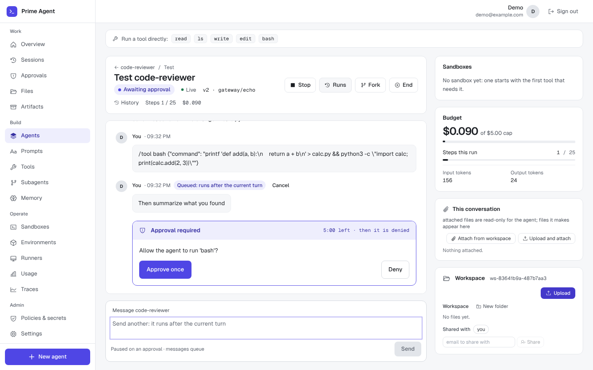

# Prime Agent

Build an agent harness in the browser, chat with it, and approve what it does.

| Folder | What it is | Port |
|---|---|---|
| `frontend/` | Next.js app | 3000 |
| `backend/` | FastAPI: users, sign-in, harness records; talks to the supervisor | 8000 |
| `prime-agent-study-main/services/supervisor/` | Runs agent sessions (API, model gateway, memory service, worker) | 8080, 8090, 8092 |

## Run it locally

```sh
./dev.sh
```

It starts Postgres (in Docker unless one already listens on port 5433), Temporal, the
supervisor and its worker, the backend and the frontend, then creates a demo user with one
ready harness. Open http://localhost:3000 and sign in with the login it prints.

First run needs:

- Python venvs: `cd prime-agent-study-main/services/supervisor && python3 -m venv .venv && .venv/bin/pip install -e '.[dev]'`,
  and the same in `backend/`
- `cd frontend && npm install`
- the [Temporal CLI](https://docs.temporal.io/cli) (`brew install temporal`)
- `127.0.0.1 model-gateway` in `/etc/hosts` (the script offers to add it)

Settings are in `.env.local`, written on first run with fresh secrets. Without a model key
every harness uses the `echo` model, which repeats your message. For a real model, set
`OPENROUTER_API_KEY` there (only the model gateway process receives it) and run `./dev.sh`
again after `./dev.sh stop`.

Other commands: `./dev.sh status`, `./dev.sh logs backend`, `./dev.sh stop`,
`./dev.sh reset` (wipes the databases and local state).

## A tour

Screenshots from `./dev.sh` with a "code-reviewer" harness (two published versions and an
unpublished change). Regenerate them with `cd frontend && node e2e/tour.mjs` (writes `docs/tour/`).

**Your harnesses.** Every harness you made, whether it is published, its model and tools, and
how many sessions you ran.


**Build it.** The builder has one tab per part of the harness. *Prompt* holds the persona and the
system prompt sections in order (`{cwd}` becomes the working directory). *Tools* picks the
built-in tools and which ones ask before running. *Model* picks a model route. *Sandbox* says where
commands run and what they may touch. *Memory* and *Policy* set compaction, step limits and approvals.


A value the platform would refuse is shown on its own tab, before anything is published:


**Publish versions.** *Publish* turns the draft into a numbered version that new sessions use.
The side panel lists what changed since the live version and every earlier one.
*Export* and *Import* move a harness between accounts as a file.


**Chat with it.** *Test* opens a session on the live version. A tool that needs approval waits
for you, with a countdown before it is denied. Messages sent meanwhile queue up. The bar shows
steps, tokens and cost, with *Stop*, *Fork* and *End*.



Tool calls show their input and output. The workspace above the chat holds the session's files:
view, download, upload or delete them, and share the session by email.


A refused call says why, in plain words:


**Come back later.** *Sessions* lists every conversation. Opening one picks up where it left off,
and *Fork from here* starts a new branch at any message.


**Memory.** What each harness remembers about you, in notebooks per version. Add, edit, forget
or search facts. *History* restores a notebook to how it was after any change.


## Checks

| What | Command |
|---|---|
| Backend tests | `cd backend && .venv/bin/python -m pytest -q tests` |
| Frontend lint, types, tests | `cd frontend && npx next lint && npx tsc --noEmit && npx vitest run` |
| In the browser (needs `./dev.sh` running) | `cd frontend && npm i --no-save playwright && npx playwright install chromium`, then `node e2e/builder-journey.mjs`, `memory-journey.mjs` and `chat-journey.mjs` |

CI runs all of these on every push, including the browser journeys against a fresh `./dev.sh`.

## Workspace files

A workspace owns its files and decides who may see them (*Shared with*). Every save is a new
**version**, and older versions are kept: open a file's history, view or download any version,
or **restore** one. Restoring adds a new version with the old content, so nothing is lost; a
deleted file can be restored the same way. **Folders** are the `/`-separated parts of file
paths, as in S3 and git. *New folder* opens one to upload into, and it stays once it holds a file.

Each version's bytes are stored under a private, opaque key, `workspaces/<scope>/objects/<id>`.
The key contains neither the file's name nor its content hash; names, folders and history live
in PostgreSQL. Identical bytes are stored once **per workspace**. No answer depends on what
another workspace holds, so uploading a file never reveals that someone else has the same one.

### Conversations, runs and artifacts

Each part has one job:

| Part | What it decides |
|---|---|
| Workspace | Who owns the files and who may see them |
| File and version | Durable content: every save is a version, kept with its author and source |
| Attachment | A workspace file used in one conversation, **pinned to a version** |
| Run | What one turn started from: its attachments and every workspace file, by version (`run_inputs`) |
| Artifact | A file a run made for the user, and which run made it |
| Sandbox | Where the agent works for now; never the place anything is kept |

**Attach** a file in *This conversation*, from the workspace or by uploading it (it is saved
in the workspace's `Attachments` folder first). The agent reads exactly that version,
read-only, in `.attachments/`. A note after the harness's own prompt tells the model where the
attachments are and that files it makes for the user go in `.outputs/`.

When a run ends, the supervisor (never the agent) **collects** what is new or changed in
`.outputs/`. It reads each file through the sandbox's path checks, so a symlink can't reach
outside the sandbox. It caps each file at 100 MiB and 50 files a run, stores each one under a
private key (`sessions/<session>/artifacts/<id>`), and records which run made it. *Save* puts
an artifact into a workspace folder as a new version whose source is that artifact. The agent's
own edits to workspace files are copied back at the end of the run as versions marked as its
own.

`.attachments/` and `.outputs/` are the session's folders, not workspace paths: they are never
copied into the workspace, refreshing the workspace leaves them alone, and uploads refuse them.

Routes (backend, per session): `GET/POST .../sessions/{id}/attachments`,
`DELETE .../attachments/{attachment}`, `GET .../artifacts`, `GET .../artifacts/{artifact}/content`,
`POST .../artifacts/{artifact}/save` with `{"path": "Reports/q4.md"}`, and
`GET .../runs/{turn}/inputs`.

### Uploads

Files go straight from the browser to object storage, and the API servers never hold the
bytes. This is the usual production pattern for S3-backed apps, and it's how OpenAI's Uploads
API is shaped:

1. **Start:** `POST /workspace/scopes/{scope}/uploads` with the path, size, type and SHA-256
   (which the browser computes). The supervisor checks the grant, the path, the size limit and
   the expected version. It answers with a short-lived signed PUT URL for a staging key
   (`uploads/<scope>/<id>`) and a signed ticket. If this workspace already holds those bytes,
   the new version is recorded at once and nothing is sent.
2. **Upload:** the browser PUTs the file to that URL, showing progress. The URL signs the
   length, type and SHA-256 checksum, so S3 refuses any other bytes.
3. **Complete:** `POST .../uploads/complete` with the ticket. The supervisor measures what
   arrived: S3's own checksum, or a streamed SHA-256 on stores that don't keep one (MinIO,
   SeaweedFS). It deletes the upload if it doesn't match. Otherwise it copies it inside the
   store to the new version's private key and records the version, along with who saved it.
   The client only ever writes its staging key, never a recorded version.

If the store can't sign URLs, or the page isn't on https/localhost (where browsers can't hash
files), the file goes through `PUT .../files/{path}` instead. It's read in chunks up to the
same limit.

History: `GET .../history/{path}` lists versions, `GET .../history/{path}/@{n}` returns one,
and `POST .../restore/{path}` with `{"version": n}` restores one.

For production:

| Setting | What it does |
|---|---|
| `WORKSPACE_MAX_UPLOAD_BYTES` (supervisor and backend) | Largest file (default 100 MiB) |
| `OBJECT_STORAGE_PUBLIC_ENDPOINT` | The address browsers use to reach the store, when the supervisor reaches it by another (e.g. a compose service name) |
| `WORKSPACE_UPLOAD_SECRET` (or `CAPABILITY_SECRET`) | Signs upload tickets; every supervisor API replica needs the same value |
| Bucket CORS | Allow `PUT` from the app's origin with headers `Content-Type` and `x-amz-checksum-sha256` (`./dev.sh` sets this locally) |
| Bucket lifecycle rule | Expire objects under `uploads/` after a day, which removes abandoned uploads (never apply it to `workspaces/`) |

Files saved before this change keep their old storage keys and are read from there; their
current state is their first recorded version.
