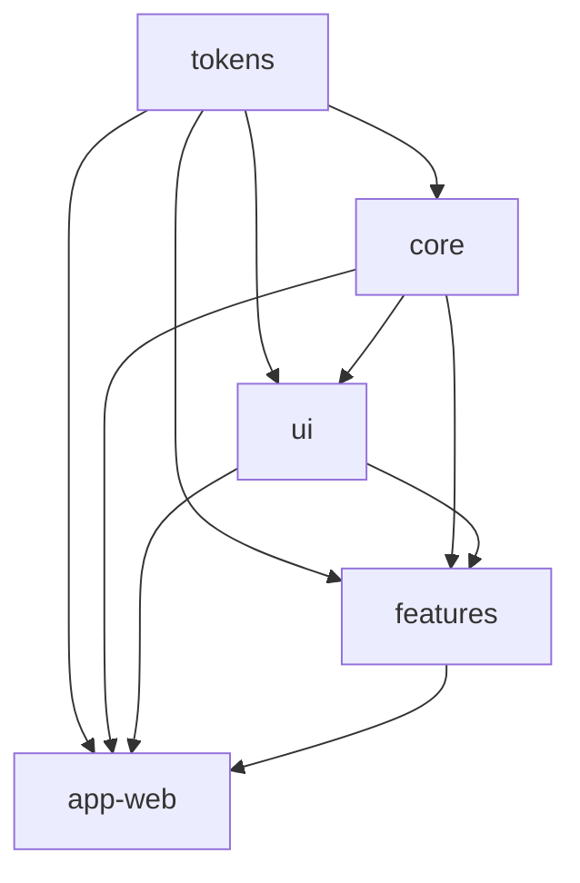

# Monorepo and Workspace Setup

## Overview

This document covers the setup and configuration of a production-grade monorepo using pnpm workspaces, including package management, dependency resolution, build orchestration, and workspace best practices.

## Workspace Configuration

### pnpm Workspace Setup

**File**: `pnpm-workspace.yaml`
```yaml
packages:
  - "packages/*"
```

This simple configuration tells pnpm to treat all directories under `packages/` as workspace packages.

### Root package.json

```json
{
  "name": "frontend-monorepo",
  "private": true,
  "type": "module",
  "packageManager": "pnpm@9.15.9",
  "engines": {
    "node": ">=22 <23",
    "pnpm": ">=9.15.0"
  },
  "scripts": {
    "dev": "pnpm --filter @scope/app-web dev",
    "build": "pnpm -r run build",
    "typecheck": "pnpm -r run typecheck",
    "lint": "eslint .",
    "format": "prettier --write .",
    "test": "pnpm run test:phase0 && pnpm run test:phase1",
    "test:phase0": "node scripts/phase0-scaffold.test.mjs",
    "test:phase1": "node scripts/phase1-foundation.test.mjs"
  },
  "devDependencies": {
    "@eslint/js": "^9.18.0",
    "eslint": "^9.18.0",
    "eslint-config-prettier": "^10.0.1",
    "eslint-plugin-boundaries": "^5.0.3",
    "prettier": "^3.4.2",
    "typescript": "^5.8.3",
    "typescript-eslint": "^8.20.0"
  }
}
```

**Key Points**:
- `"private": true` - Prevents accidental publishing
- `"type": "module"` - Use ESM by default
- `packageManager` - Locks pnpm version (Corepack)
- `engines` - Enforces Node.js version

## Package Structure

### Directory Layout

```
frontend/
├── package.json                 # Root configuration
├── pnpm-workspace.yaml         # Workspace definition
├── pnpm-lock.yaml              # Lockfile (commit this!)
├── tsconfig.base.json          # Shared TypeScript config
├── eslint.config.js            # ESLint flat config
├── .prettierrc.json            # Prettier config
├── .prettierignore             # Prettier ignore rules
├── .gitignore                  # Git ignore rules
├── packages/
│   ├── tokens/                 # @scope/tokens
│   │   ├── package.json
│   │   ├── tsconfig.json
│   │   ├── src/
│   │   └── dist/
│   ├── core/                   # @scope/core
│   │   ├── package.json
│   │   ├── tsconfig.json
│   │   └── src/
│   ├── ui/                     # @scope/ui
│   │   ├── package.json
│   │   ├── tsconfig.json
│   │   └── src/
│   ├── features/               # @scope/features
│   │   ├── package.json
│   │   ├── tsconfig.json
│   │   └── src/
│   └── app-web/                # @scope/app-web
│       ├── package.json
│       ├── tsconfig.json
│       ├── vite.config.ts
│       ├── index.html
│       └── src/
├── contracts/                  # Shared types (OpenAPI)
└── scripts/                    # Build & test scripts
    ├── phase0-scaffold.test.mjs
    └── phase1-foundation.test.mjs
```

### Package Naming Convention

**Pattern**: `@scope/package-name`

**Examples**:
- `@yal/tokens` - Design tokens
- `@yal/core` - Core utilities
- `@yal/ui` - UI components
- `@yal/features` - Feature modules
- `@yal/app-web` - Main application

**Benefits**:
- Namespace collision prevention
- Clear ownership
- NPM scoped packages support
- Easier to search/filter

## Individual Package Configuration

### Package.json Structure

#### Tokens Package

```json
{
  "name": "@yal/tokens",
  "version": "0.1.0",
  "type": "module",
  "main": "./dist/tokens.css",
  "types": "./dist/index.d.ts",
  "exports": {
    ".": {
      "types": "./dist/index.d.ts",
      "default": "./dist/tokens.css"
    },
    "./tokens.css": "./dist/tokens.css"
  },
  "files": ["dist"],
  "scripts": {
    "build": "node style-dictionary.config.mjs",
    "dev": "node style-dictionary.config.mjs --watch",
    "typecheck": "tsc --noEmit"
  },
  "devDependencies": {
    "style-dictionary": "^4.2.0",
    "typescript": "^5.8.3"
  }
}
```

#### Core Package

```json
{
  "name": "@yal/core",
  "version": "0.1.0",
  "type": "module",
  "main": "./dist/index.js",
  "types": "./dist/index.d.ts",
  "exports": {
    ".": {
      "types": "./dist/index.d.ts",
      "default": "./dist/index.js"
    },
    "./transport": {
      "types": "./dist/transport/index.d.ts",
      "default": "./dist/transport/index.js"
    },
    "./format": {
      "types": "./dist/format/index.d.ts",
      "default": "./dist/format/index.js"
    }
  },
  "files": ["dist"],
  "scripts": {
    "build": "tsc",
    "dev": "tsc --watch",
    "typecheck": "tsc --noEmit",
    "test": "node --test src/**/*.test.ts"
  },
  "dependencies": {
    "@yal/tokens": "workspace:*"
  },
  "devDependencies": {
    "@types/node": "^22.10.5",
    "typescript": "^5.8.3"
  }
}
```

#### UI Package

```json
{
  "name": "@yal/ui",
  "version": "0.1.0",
  "type": "module",
  "main": "./dist/index.js",
  "types": "./dist/index.d.ts",
  "exports": {
    ".": {
      "types": "./dist/index.d.ts",
      "default": "./dist/index.js"
    },
    "./styles": "./dist/styles.css"
  },
  "files": ["dist"],
  "scripts": {
    "build": "tsc && vite build",
    "dev": "tsc --watch",
    "typecheck": "tsc --noEmit",
    "ladle": "ladle serve"
  },
  "dependencies": {
    "@radix-ui/react-dialog": "^1.1.4",
    "@radix-ui/react-tooltip": "^1.1.8",
    "@yal/core": "workspace:*",
    "@yal/tokens": "workspace:*",
    "lucide-react": "^0.468.0",
    "react": "^19.2.8",
    "react-dom": "^19.2.8"
  },
  "devDependencies": {
    "@ladle/react": "^4.3.0",
    "@types/react": "^19.0.10",
    "@types/react-dom": "^19.0.5",
    "typescript": "^5.8.3",
    "vite": "^6.3.3"
  },
  "peerDependencies": {
    "react": "^19.0.0",
    "react-dom": "^19.0.0"
  }
}
```

#### App Package

```json
{
  "name": "@yal/app-web",
  "version": "0.1.0",
  "type": "module",
  "private": true,
  "scripts": {
    "dev": "vite",
    "build": "tsc && vite build",
    "preview": "vite preview",
    "typecheck": "tsc --noEmit"
  },
  "dependencies": {
    "@tanstack/react-query": "^5.64.5",
    "@tanstack/react-router": "^1.112.2",
    "@yal/core": "workspace:*",
    "@yal/features": "workspace:*",
    "@yal/tokens": "workspace:*",
    "@yal/ui": "workspace:*",
    "react": "^19.2.8",
    "react-dom": "^19.2.8"
  },
  "devDependencies": {
    "@types/react": "^19.0.10",
    "@types/react-dom": "^19.0.5",
    "@vitejs/plugin-react": "^4.3.4",
    "typescript": "^5.8.3",
    "vite": "^6.3.3"
  }
}
```

### Workspace Dependencies

**Pattern**: `"workspace:*"`

**Examples**:
```json
{
  "dependencies": {
    "@yal/core": "workspace:*",
    "@yal/tokens": "workspace:*"
  }
}
```

**How it works**:
- During development: Links to local package
- During publish: Replaced with actual version
- Always uses latest local code
- No need to version bump during dev

## pnpm Commands

### Package Filtering

```bash
# Run command in specific package
pnpm --filter @yal/app-web dev
pnpm --filter @yal/ui build

# Run in multiple packages (pattern matching)
pnpm --filter "@yal/ui" --filter "@yal/core" build

# Run in all packages
pnpm -r run build              # Recursive
pnpm --parallel -r run build   # Parallel execution
```

### Dependency Management

```bash
# Add dependency to specific package
pnpm --filter @yal/ui add react

# Add dev dependency
pnpm --filter @yal/app-web add -D vite

# Add workspace dependency
pnpm --filter @yal/ui add @yal/core@workspace:*

# Add dependency to root (dev tools)
pnpm add -D -w eslint

# Update all dependencies
pnpm update -r

# Install all dependencies
pnpm install
```

### Running Scripts

```bash
# Run script in all packages
pnpm -r run typecheck

# Run in topological order (respects dependencies)
pnpm -r --workspace-concurrency=1 run build

# Run in parallel
pnpm -r --parallel run test
```

## Build Order and Orchestration

### Topological Sorting

pnpm automatically builds packages in dependency order:

```
1. @yal/tokens (no dependencies)
2. @yal/core (depends on tokens)
3. @yal/ui (depends on core, tokens)
4. @yal/features (depends on ui, core, tokens)
5. @yal/app-web (depends on all)
```

### Build Script Example

```bash
#!/bin/bash
# Build all packages in order

echo "Building tokens..."
pnpm --filter @yal/tokens build

echo "Building core..."
pnpm --filter @yal/core build

echo "Building UI..."
pnpm --filter @yal/ui build

echo "Building features..."
pnpm --filter @yal/features build

echo "Building app..."
pnpm --filter @yal/app-web build

echo "✓ All packages built"
```

**Or simply**:
```bash
pnpm -r run build
```

## TypeScript Project References

### Base Configuration

**File**: `tsconfig.base.json`
```json
{
  "compilerOptions": {
    "target": "ES2022",
    "lib": ["ES2022"],
    "module": "ESNext",
    "moduleResolution": "bundler",
    "resolveJsonModule": true,

    // Strict mode
    "strict": true,
    "noUncheckedIndexedAccess": true,
    "exactOptionalPropertyTypes": true,
    "noImplicitOverride": true,
    "noUnusedLocals": true,
    "noUnusedParameters": true,
    "noFallthroughCasesInSwitch": true,

    // Build
    "declaration": true,
    "declarationMap": true,
    "sourceMap": true,
    "isolatedModules": true,
    "verbatimModuleSyntax": true,
    "skipLibCheck": true,

    // Path aliases
    "baseUrl": ".",
    "paths": {
      "@yal/tokens": ["./packages/tokens/src"],
      "@yal/core": ["./packages/core/src"],
      "@yal/ui": ["./packages/ui/src"],
      "@yal/features": ["./packages/features/src"]
    }
  }
}
```

### Package-Specific Config

**core/tsconfig.json**:
```json
{
  "extends": "../../tsconfig.base.json",
  "compilerOptions": {
    "rootDir": "src",
    "outDir": "dist",
    "composite": true,
    "lib": ["ES2022", "DOM"]  // NO React
  },
  "include": ["src"],
  "exclude": ["src/**/*.test.ts", "dist", "node_modules"]
}
```

**ui/tsconfig.json**:
```json
{
  "extends": "../../tsconfig.base.json",
  "compilerOptions": {
    "rootDir": "src",
    "outDir": "dist",
    "composite": true,
    "jsx": "react-jsx",
    "lib": ["ES2022", "DOM", "DOM.Iterable"]
  },
  "include": ["src"],
  "references": [
    { "path": "../core" },
    { "path": "../tokens" }
  ]
}
```

**app-web/tsconfig.json**:
```json
{
  "extends": "../../tsconfig.base.json",
  "compilerOptions": {
    "rootDir": "src",
    "outDir": "dist",
    "jsx": "react-jsx",
    "lib": ["ES2022", "DOM", "DOM.Iterable"],
    "types": ["vite/client"],
    "noEmit": true  // Vite handles build
  },
  "include": ["src"],
  "references": [
    { "path": "../tokens" },
    { "path": "../core" },
    { "path": "../ui" },
    { "path": "../features" }
  ]
}
```

## Dependency Graph Visualization



## Common Workflows

### Adding a New Package

```bash
# 1. Create package directory
mkdir packages/new-package
cd packages/new-package

# 2. Initialize package.json
pnpm init

# 3. Update package.json
{
  "name": "@yal/new-package",
  "version": "0.1.0",
  "type": "module",
  "main": "./dist/index.js",
  "types": "./dist/index.d.ts"
}

# 4. Create tsconfig.json
{
  "extends": "../../tsconfig.base.json",
  "compilerOptions": {
    "rootDir": "src",
    "outDir": "dist"
  }
}

# 5. Create src/index.ts
export function hello() {
  return "Hello from new-package";
}

# 6. Install (from root)
cd ../..
pnpm install
```

### Adding Dependencies

```bash
# Add external dependency
pnpm --filter @yal/ui add react-hook-form

# Add workspace dependency
pnpm --filter @yal/features add @yal/ui@workspace:*

# Add dev dependency
pnpm --filter @yal/core add -D @types/node
```

### Publishing Workflow

```bash
# 1. Version bump
pnpm --filter @yal/ui version patch

# 2. Build
pnpm --filter @yal/ui build

# 3. Publish (if public)
pnpm --filter @yal/ui publish
```

## Best Practices

### 1. Package Boundaries

**Enforce with ESLint**:
```javascript
{
  plugins: { boundaries },
  rules: {
    "boundaries/element-types": ["error", {
      default: "disallow",
      rules: [
        { from: "tokens", allow: [] },
        { from: "core", allow: ["core", "tokens"] },
        { from: "ui", allow: ["ui", "core", "tokens"] },
        { from: "features", allow: ["features", "ui", "core", "tokens"] },
        { from: "app", allow: ["*"] }
      ]
    }]
  }
}
```

### 2. Dependency Management

- Use `workspace:*` for local packages
- Pin external dependencies to specific versions
- Use `peerDependencies` for shared libraries (React, etc.)
- Keep devDependencies in root when shared

### 3. Build Optimization

```json
{
  "scripts": {
    "build": "tsc --build",
    "build:clean": "tsc --build --clean && tsc --build"
  }
}
```

### 4. Testing Strategy

```bash
# Test all packages
pnpm -r run test

# Test specific package
pnpm --filter @yal/core test

# Test changed packages only
pnpm --filter="...[origin/main]" test
```

### 5. Version Management

**Options**:
1. **Independent versioning** - Each package has own version
2. **Fixed versioning** - All packages share version (Lerna-style)
3. **Semantic versioning** - Follow semver strictly

**Recommended**: Independent versioning for flexibility

### 6. Lockfile Management

- **Commit** `pnpm-lock.yaml` to version control
- **Never** modify manually
- Use `pnpm install --frozen-lockfile` in CI
- Update regularly: `pnpm update -r`

## CI/CD Integration

### GitHub Actions Example

```yaml
name: CI

on: [push, pull_request]

jobs:
  test:
    runs-on: ubuntu-latest
    steps:
      - uses: actions/checkout@v4

      - uses: pnpm/action-setup@v4
        with:
          version: 9.15.9

      - uses: actions/setup-node@v4
        with:
          node-version: 22
          cache: 'pnpm'

      - run: pnpm install --frozen-lockfile

      - run: pnpm -r run typecheck

      - run: pnpm run lint

      - run: pnpm -r run test

      - run: pnpm -r run build
```

## Troubleshooting

### Common Issues

**Issue**: Circular dependencies
```bash
# Detect with
pnpm list --depth=Infinity

# Fix by restructuring packages
```

**Issue**: Phantom dependencies
```bash
# Enable strict mode in .npmrc
node-linker=hoisted
strict-peer-dependencies=true
```

**Issue**: Build order problems
```bash
# Clean and rebuild in order
pnpm -r run clean
pnpm -r --workspace-concurrency=1 run build
```

**Issue**: Type errors in IDE but not CLI
```bash
# Rebuild TypeScript references
pnpm -r exec tsc --build --clean
pnpm -r exec tsc --build
```

## Conclusion

A well-configured monorepo with pnpm workspaces provides:

- **Fast installs** - Shared dependencies, hard links
- **Type safety** - Project references
- **Dependency isolation** - Strict boundaries
- **Developer experience** - Fast builds, hot reload
- **Scalability** - Add packages without complexity

The patterns shown here support teams of any size building production applications.
