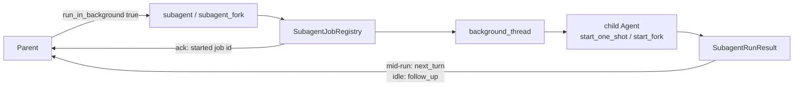
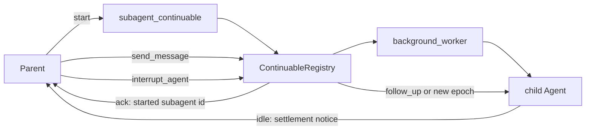
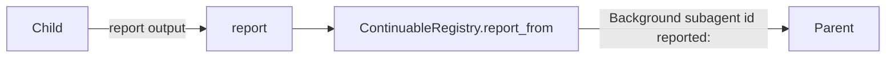

# How subagents work in DeepSeek harness

DeepSeek does **not** put “run a child agent” inside the agent loop. It splits the problem into layers: a **service**, **providers** (how the child runs), and **model-facing tools** (what the parent/child models see).

---

## 1. The big picture

```text
Parent model
    │
    ▼
tool: subagent / subagent_fork     ← model-facing (tool-subagent)
    │
    ▼
ctx.subagents                      ← service (dsh-subagent)
    │
    ├── spawn / fork / acp / …     ← providers (how child is created)
    │
    ▼
Child Agent (own session, own loop)
    │
    ├── (optional) report          ← child → parent
    └── parent: send_message / interrupt_agent / list_agents
```

| Layer | Package | Job |
|---|---|---|
| Service | `dsh-subagent` | Registry, depth, descriptors, one-shot runs, continuable Activations |
| Providers | `spawn`, `fork`, ACP, Codex, … | Create the child (in-process or remote) |
| Parent tools | `tool-subagent`, `tool-subagent-control` | Start / message / interrupt / list |
| Child tool | `tool-subagent-report` | `report` only inside continuable children |

The parent never sees the child’s intermediate tool steps. It only gets a **final summary** (foreground), a **job/child id** (background), and later **settlement / report** messages.

---

## 2. Two kinds of child (the core design)

### A. One-shot (`SubagentRun`)

- Parent starts a child for **one job**.
- Parent either:
  - **Foreground:** waits for `run.result`, then `dispose()`.
  - **Background:** registers a Job/Task, returns `jobId`, collects later via job tools.
- Child has **no durable conversation** the parent keeps chatting with.
- Result shape: `{ output, structured?, stopReason }`  
  Only `stopReason === 'completed'` is success; abort / max-tokens / refusal / error become errored tool results (partial text may still be attached).

### B. Continuable (Activation + durable Session)

- Parent starts a **long-lived** child session.
- Start returns as soon as the child’s **inbox accepts** the first prompt — **not** when the turn finishes.
- Later work: parent calls `send_message` → child’s next FIFO turn (`Agent.followup`).
- Child can call `report` to push text up to the live parent.
- When the child’s residency ends, the **service** injects a **settlement notice** into the parent (“Background subagent X finished…”) even if the child never reported — so token limits / cancels still notify the parent.
- No `SubagentRun` / Job for this path: the durable session **is** the product.

Shipped composition typically:

- `subagent` → spawn + **continuable** (default background)
- `subagent_fork` → fork + **one-shot** (default foreground; fork stays one-shot so KV-cache / prompt deltas stay sane)

---

## 3. Lifecycle (one-shot, foreground)

```text
1. Model calls subagent({ description, prompt, run_in_background? })
2. Tool builds SubagentStartRequest { parent, prompt, signal, maxDepth, … }
3. ctx.subagents.start(providerName, request)
      - check provider capabilities (depth, tools, persona, schema)
      - snapshot durable descriptor
      - provider creates child Agent + session
4. Ownership transfers → SubagentRun { id, result, dispose, localAgent? }
5. Tool awaits result
6. Tool always dispose() before returning
7. Parent tool result = child's final text only
```

**Ownership rule:** before publish, provider cleans up on failure; after publish, caller must `dispose()`.

---

## 4. Lifecycle (continuable)

```text
1. startContinuable(spec) → { childId, messageId } at inbox accept
2. Child Activation is process-local residency of that session
3. Parent may send_message / interrupt_agent / list_agents
4. Child may report → parent gets a framed user message
5. When Activation settles → service sends settlement notice to parent
6. Teardown is child-first; interrupt stops current turn but keeps inbox
```

**Authority:**

- Follow-up / report: **exact live direct parent** (or exact live child for report).
- Interrupt: wider — durable parent address **or** any exact live **ancestor**.
- Ask-user: blocked for owned children (`DELEGATED_CALLER`) — child must put unresolved questions in its final/report text, not quiz the human.

---

## 5. Spawn vs fork (history only)

| | **Spawn** | **Fork** |
|---|---|---|
| History | Fresh empty session | Seeded with parent’s **completed** turns only |
| In-flight turn | N/A | **Excluded** (open tool-call turn would be unbalanced) |
| Tools / authority | Fresh composition + optional filter | Same — **not** parent’s live tool authority |
| Prompt | Must be **standalone** | Can assume parent context already known |

`inheritsParentContext` is descriptive: “does the child see parent history?” — not “does it inherit permissions.”

---

## 6. Depth, policy, composition

**Depth**

- `SessionHeader.delegationDepth` is authoritative and **monotone** (resume cannot reset to 0).
- Runtime `subagentDepth` may only deepen.
- Tool default `maxDepth: 3` (0 = no delegation). Tool stays visible at the cap; start fails with an errored tool result if over budget.

**Policy (in-process)**

- Child sandbox: snapshot of parent override (or deployment default).
- Approval: pinned to **`never`** for delegated children — no human sitting on the child’s ask channel.
- Runtime context statement: scope is fixed; don’t retry for wider access — report the limitation.

**Composition**

- Child joins parent’s **agent-preset** composition, then applies persona / tool filter.
- Without that join, the child would see an empty tool registry.

---

## 7. What the models actually see

**Parent**

- Tool schemas: `subagent` / `subagent_fork`, optionally `send_message`, `interrupt_agent`, `list_agents`.
- Foreground success: child’s final text.
- Background start: `started subagent <id>` or `started background subagent job <id>`.
- Later: settlement notices and/or `report` frames — not the child’s whole transcript.

**Child**

- Own session + tools (minus filter).
- Delegation-scope statement in runtime context.
- Continuable only: `report` tool + prompt section (“report once before finishing”).
- No ask-user to the human while owned by another live agent.

---

## 8. Mental model in one sentence

> A **provider** creates a child; the **service** owns depth, descriptors, and (for continuable) residency/settlement; the **tools** are thin adapters so the parent model only starts/steers children and receives summaries — never the child’s intermediate loop.

---

## 9. githi implementation status

### Phase 1 — spawn (done)

| Piece | Location |
|---|---|
| Service | [`src/githi/subagent/`](src/githi/subagent/) — `SubagentService.start_one_shot` |
| Tool | `subagent` in [`tools/subagent.py`](src/githi/tools/subagent.py) |
| Depth | `delegation_depth` on `Agent` + `max_depth` default **3** |
| No ask-user on child | `delegated=True` → `DELEGATED_CALLER` |
| Foreground await | Nested `child.run(prompt)`; parent tool result = final text only |

### Phase 2 — fork (done)

| Piece | Location |
|---|---|
| Seed | [`subagent/seed.py`](src/githi/subagent/seed.py) — `completed_turn_prefix` |
| Service | `SubagentService.start_fork` |
| Tool | `subagent_fork` in [`tools/subagent_fork.py`](src/githi/tools/subagent_fork.py) |

Child sees **completed** parent turns only (not the open tool-call turn). Empty completed history → same as a fresh child aside from any retained system message.

### Phase 3 — background one-shot + settlement notice (done)

Parent calls `subagent` / `subagent_fork` with `run_in_background: true`, gets a job id **immediately**, keeps working, and later gets a **settlement notice** via `next_turn` / `follow_up`. Optional `job_output` / `job_kill` for recovery and cancel. Foreground (`run_in_background` false/omitted) stays as phases 1–2.



| Piece | Location |
|---|---|
| Registry | [`subagent/jobs.py`](src/githi/subagent/jobs.py) — `SubagentJobRegistry` on `Agent.subagent_jobs` |
| Active flag | `Agent._run_active` + `deliver_background_notice` |
| Tools | `run_in_background` on `subagent` / `subagent_fork`; `job_output`; `job_kill` |
| LLM lock | `LLMClient._call_lock` around `complete` / `stream` |

Settlement text:

```text
Background subagent job <id> finished (<stop_reason>).
Its closing message:
<output or "It left no closing message.">
```

### Phase 4 — continuable sessions (done)

Durable child (not a Job): `subagent_continuable` returns at **inbox accept**, parent steers with `send_message`, cancels the current turn with `interrupt_agent` (queued messages kept). When the child goes idle, a settlement notice is injected; `send_message` can wake the same child for another epoch.



| Piece | Location |
|---|---|
| Registry | [`subagent/continuable.py`](src/githi/subagent/continuable.py) — `ContinuableRegistry` on `Agent.subagent_continuable` |
| Start tool | `subagent_continuable` → `started subagent <id>` |
| Control | `send_message`, `interrupt_agent` |
| Settlement | DeepSeek-style summary lines (child id, not job id) via `deliver_background_notice` |

Settlement example (`done`):

```text
Background subagent <id> finished and will do no further work unless you send it more.
Its closing message:
<output or "It left no closing message.">
```

**Out of scope for phase 4:** child `report`, `list_agents`, cold resume from disk, out-of-process providers.

### Phase 5 — child `report` (done)

Continuable children get a **`report`** tool (not on the parent, not on one-shot spawn/fork). Calling it relays a framed user message to the live parent via `deliver_background_notice`. Reporting does **not** settle the child or end its turn; settlement still arrives on idle even if the child never reported.



| Piece | Location |
|---|---|
| Framing / delivery | [`continuable.py`](src/githi/subagent/continuable.py) — `format_report_notice`, `report_from` |
| Tool | [`tools/report.py`](src/githi/tools/report.py) — installed only in `_install_report` |
| Sink | `Agent.report_sink` → `ToolContext.extra["report_sink"]` |

Report frame:

```text
Background subagent <id> reported:
<output>
```

Ack to the child: `report accepted by the agent that started you as message <message_id>`.

### Phase 6 — `list_agents` (done)

Parent-facing inventory of **continuable** children only (one-shot Jobs never appear).

| Piece | Location |
|---|---|
| Tool | [`tools/list_agents.py`](src/githi/tools/list_agents.py) |
| Source | `ContinuableRegistry.list_children()` |

- Render: `(no subagents)` or `{id} [{status}] — {label}`
- Status: internal `running` → `running`; parked (`ready`, no live Agent) → `ready`
- Optional `scope` (`children` \| `descendants`) accepted; both return the flat direct-child list for now

### Phase 7 — in-process cold resume (done)

After settlement, the live child **Agent is parked**: transcript kept in memory on `ContinuableChild.messages`, `agent=None`, status **`ready`**. `send_message` rebuilds the Agent from that transcript (`_materialize_locked`), reinstalls `report`, and starts a new epoch. No disk yet — process restart still loses children.

| Piece | Location |
|---|---|
| Park / materialize | [`continuable.py`](src/githi/subagent/continuable.py) — `_cold_park_locked`, `_materialize_locked` |
| list status | `ready` when not live |

**Still deferred:** disk persistence (survive process restart), nested descendant trees, out-of-process providers, structured output schema, generic Jobs for bash.

### Hardening (done) — loophole fixes

Red–green–refactor pass over the in-process slice:

1. Background **fork seed** captured at job ack time (not on the worker later)
2. Continuable **`send_message` vs park** race closed (`in_run` + re-absorb before park)
3. Settlement **wake**: promote undrained `next_turn` → `follow_up`; `Agent.continue_queued` + REPL auto-continue
4. Children **deny** parent-only tools (`PARENT_ONLY_TOOLS`)
5. **ESC** cancels owned background jobs + running continuables (`abort_owned_background`)
6. Children **inherit** `subagents.max_depth`

### Example prompts

```text
Use the subagent tool to research whether this workspace has a README,
with a self-contained prompt that tells the child to list files and
report back in one short paragraph. Then summarize its answer.
```

```text
We already discussed preferring pytest. Use subagent_fork to add a tiny
test helper consistent with that choice; the child can see our prior turns.
```

```text
Start a background subagent to survey large files in the workspace
(run_in_background true), keep editing README yourself, then use the
settlement notice or job_output when it finishes.
```

```text
Start a continuable subagent to explore the repo (subagent_continuable).
When you get the start ack, keep working; after the settlement notice,
send_message a follow-up question to the same subagent id.
```

```text
Start a continuable subagent whose prompt tells it to call report with a
short finding before it finishes; summarize the report notice when it arrives.
```

```text
Call list_agents to see your continuable children, then send_message to
a ready one with a follow-up question.
```
